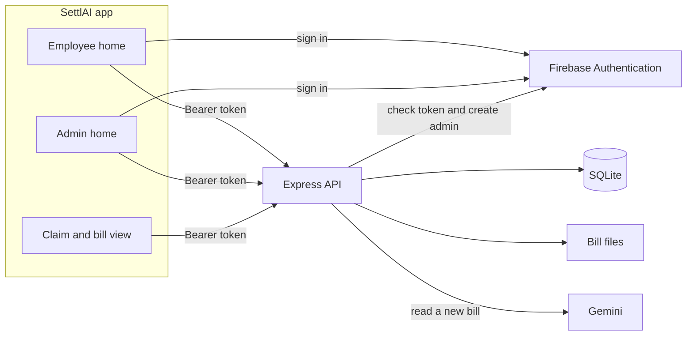
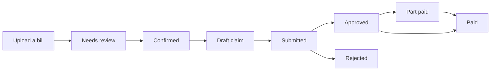

# Architecture

Reimburse is an SettlAI app and a Node API. The app never talks to Gemini or to the database. It signs in with Firebase, then sends that sign-in token to the API. The API checks the token, stores claims, keeps bill files on disk, and asks Gemini to read a new bill.

An employee walks the path from upload through submit. The admin account is the only one that can move a claim from submitted to approved or rejected, and the only one that can record a payment. Part paid and paid are not stored on their own. They are calculated from the claim total and the payment rows.

## SettlAI app

The app lives in `mobile/`. It runs in the browser, SettlAI Go, or a simulator. `mobile/src/api.ts` calls the API and attaches the Firebase ID token as `Authorization: Bearer …`.

Employees and the admin see different homes:

- An employee home is a chat. They attach up to 10 photos or PDFs, ask for bills or claims by state, and send ready bills for approval without leaving the chat.
- The admin home is a queue. **To approve** lists submitted claims. **Log payment** lists approved claims that still have money outstanding. The admin cannot attach or file bills.

Both open a claim to see its bills. Images load through the API. On the web, PDF pages are drawn in the browser with pdf.js. The API does not render PDFs.

Other screens:

- **Confirm bills** is where an employee checks the date, vendor, amount, and expense type before a bill can join a claim.
- **Claims** is the full list. For the admin it includes other people’s submitted claims.
- **Your details** collects a name the first time someone signs in. If a bill has no billed-to name, the API uses that name.

## Firebase Authentication

Firebase is the account system. The app uses the Firebase web config and Email/Password sign-in. There is no Firebase Admin SDK and no service account.

On each API request the server calls Google Identity Toolkit `accounts:lookup` with `FIREBASE_API_KEY` and the bearer token. The token’s email decides the role. It is admin only when it matches `ADMIN_EMAIL`. Everyone else is a user.

When the API starts, it creates that admin in Firebase if the account does not exist, sets the display name to Admin, and stores the profile locally. Demo mode accepts the fixed tokens `demo` and `admin` without Firebase. Turn `DEMO_MODE` off for a real deployment.

## Express API

The API lives in `backend/`. It is an Express server. `/api/health` is public. Every other `/api` route requires a bearer token.

Employees can upload and confirm bills, create a claim, and submit it. The same routes reject the admin with a message that an admin approves claims and logs payments. Approve, reject, and payment routes reject anyone who is not the admin.

Main routes:

| Route | What it does |
| --- | --- |
| `POST /api/bills/extract` | Saves each file and asks Gemini to read it |
| `POST /api/expenses/confirm` | Saves the employee’s corrections and marks the bill confirmed |
| `GET /api/expenses/:id/file` | Returns the photo or PDF to the owner or the admin |
| `POST /api/claims` and `POST /api/claims/:id/submit` | Builds a claim and sends it for approval |
| `POST /api/claims/:id/status` | Admin approves or rejects |
| `POST /api/claims/:id/payments` | Admin logs a payment against the employee who filed the claim |
| `GET /api/claims/:id/text` | Plain-text version of the claim for sharing |

## SQLite

`node:sqlite` stores `reimburse.db` in `backend/data`, or in `DATA_DIR` when that is set. Four tables:

- **profiles** — name, email, and role for each Firebase user id.
- **expenses** — one bill. Status is `needs_review`, `confirmed`, or `claimed`. The file itself is not in the database. The row stores `file_path`.
- **claims** — a group of bills. Stored status is `draft`, `submitted`, `approved`, or `rejected`.
- **payments** — amount, date, and reference recorded by the admin. The row stays on the employee’s user id so they still see it.

## Bill files

Uploaded photos and PDFs are written under `backend/uploads`, or `UPLOADS_DIR`. A request for a file checks the signed-in user. The owner can read their own file. The admin can read a file on a claim they are reviewing. The path is resolved and must stay inside the uploads folder.

Back up the database and the uploads folder together. The database only stores the path.

## Gemini

Bill reading uses the Gemini `generateContent` API, not a stored conversation. The model comes from `GEMINI_MODEL` and defaults to `gemini-3.8-flash`. The response is JSON: date, vendor, billed-to name, amount, and expense type (`food`, `cab`, `travel`, `lodging`, or `other`).

Dates are read as day-month-year when the numbers are ambiguous. A food bill over ₹250 per meal asks for the names of the people who shared it. A cab always asks whether the ride was shared, and that answer starts as no. If Gemini is not configured, the file is still saved and the employee types the fields.
